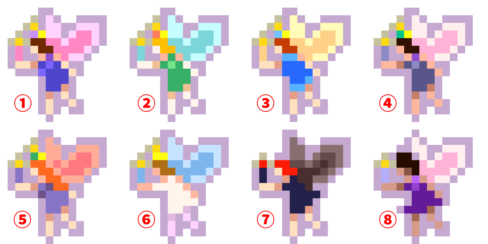

# StardewFairySearcher

A C# console application for Stardew Valley 1.6 Fairy Type prediction and ID searching.

## Background

In Stardew Valley 1.6, the Fairy Box's appearance cannot be changed by reforging. Its Fairy Type is determined by the `UniqueMultiplayerID` of the player associated with the save file. More specifically, the game uses this ID as a pseudo-random seed to select the Fairy Type.

This program reproduces the relevant game logic, allowing you to predict the Fairy Type associated with a given `UniqueMultiplayerID`.

It also simulates the game's `UniqueMultiplayerID` generation process. By generating new IDs and calculating their corresponding Fairy Types, the program can search for valid IDs that produce a specific Fairy Type.

You can then replace your current `UniqueMultiplayerID` with one of these generated IDs by editing your save file, allowing you to change the Fairy Box's appearance in-game.

## Features

- Predict Fairy Type (1-8) from Multiplayer ID
- Search random Multiplayer IDs for a specific Fairy Type
- Display computed seed, Sub-Variant, and Sprite Y Offset
- Generate random 64-bit Multiplayer IDs

## Download

Precompiled single-file Windows executables are available on the [Releases](../../releases) page.

Download the latest release and run `StardewFairySearcher.exe`. No separate .NET runtime installation is required.

## Build from Source

Requirements:
- .NET SDK

Clone the repository:

```bash
git clone https://github.com/tiehu/StardewFairySearcher.git
cd StardewFairySearcher
```

Run the application:

```bash
dotnet run
```

## Usage

- `1`: Predict Fairy Type from Multiplayer ID
- `2`: Search random IDs for a specific Fairy Type
- `0`: Exit

## Prediction Details

The Fairy Type is determined by the following values:

- **SubVariant (0-3):** Selects one of four horizontal positions in the sprite sheet.
- **Sprite Y Offset (0 or 176):** Selects the upper or lower row of the sprite sheet.

The final Fairy Type ranges from 1 to 8.

## Fairy Types

The following chart shows the appearance of each Fairy Type:



## Credits and Licensing

### Third-Party Libraries

This project uses the following third-party library:

- [System.Data.HashFunction.xxHash](https://www.nuget.org/packages/System.Data.HashFunction.xxHash) - xxHash implementation used for Fairy Type prediction.

### Image Credits

The Fairy Types reference image is based on [Fairy Box Colors.png](https://stardewvalleywiki.com/File:Fairy_Box_Colors.png) from the [Stardew Valley Wiki](https://stardewvalleywiki.com/).

The image has been modified for this project, including resizing and adding type numbers.

The original image and this modified version are used under the [Creative Commons Attribution-NonCommercial-ShareAlike 3.0 Unported License (CC BY-NC-SA 3.0)](https://creativecommons.org/licenses/by-nc-sa/3.0/).

The modified image is distributed under the same license.

Stardew Valley and its related assets are the property of their respective copyright holders. This project is an unofficial fan-made tool and is not affiliated with or endorsed by ConcernedApe.